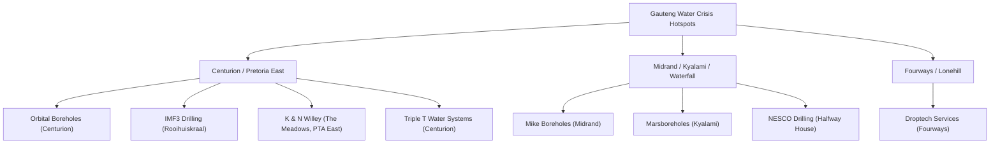

# 💧 Borehole Drilling & Backup Water Contractors (Gauteng)

> [!IMPORTANT]
> **High-Ticket Market Context:** Due to ongoing municipal water outages across Tshwane and Johannesburg, borehole drilling (**R60,000 – R120,000**) and JoJo backup water systems (**R18,000 – R35,000**) represent the highest-margin trade services in South Africa.
> All 8 contractors listed below have **zero active websites or custom domains**, relying exclusively on Facebook and word-of-mouth.

---

## 🎯 Discovered Zero-Website Prospects

| # | Business Name | Area / Suburb | Phone | Facebook Profile | Core Trade Focus | Status |
| :-: | :--- | :--- | :---: | :--- | :--- | :---: |
| **1** | **Mike Boreholes & Irrigations** | Midrand, GP | `081 746 7042` | [Facebook Page](https://www.facebook.com/p/mike-boreholes-irrigations-61574048533430/) | Deep borehole drilling, casing, irrigation | `#status/lead` |
| **2** | **Marsboreholes & Water Tech** | Midrand & Kyalami, GP | `060 781 4558` | [Facebook Page](https://www.facebook.com/61581328961316/) | Yield testing, residential borehole drilling | `#status/lead` |
| **3** | **Orbital Borehole Drilling** | Centurion Residential Estate, GP | `067 606 7828` | [Facebook Page](https://www.facebook.com/p/orbital-borehole-drilling-installation-61556518841759/) | Estate drilling, automated pump setups | `#status/lead` |
| **4** | **IMF3 Borehole Drilling** | Centurion & Rooihuiskraal, GP | `063 956 7960` | [Facebook Page](https://www.facebook.com/imf3boreholedrillingcenturion/) | Sinking boreholes, clean-outs, booster pumps | `#status/lead` |
| **5** | **K & N Willey Backup Water** | The Meadows Estate, Pretoria East | `063 655 1066` | [Facebook Page](https://www.facebook.com/homemaintenanceandconstruction/) | Municipal backup tanks, changeover valves | `#status/lead` |
| **6** | **NESCO Borehole Drilling** | Midrand & Halfway House, GP | `072 411 5472` | [Facebook Page](https://www.facebook.com/people/nesco-borehole-drilling/61577566067720/) | Rotary drilling, pump repairs, JoJo tanks | `#status/lead` |
| **7** | **Triple T Borehole Drilling** | Centurion, GP | `063 082 5674` | [Facebook Page](https://www.facebook.com/61575344663448/) | Water continuity, emergency pumps | `#status/lead` |
| **8** | **Droptech Borehole Services** | Fourways & Midrand, GP | `060 348 8268` | [Facebook Page](https://www.facebook.com/profile.php/?id=61584671191395) | Submersible pump installations, pressure tanks | `#status/lead` |

---

## 📍 Geographic Suburb Hotspots



---

## 💬 WhatsApp Pitch Angle for Water Contractors

> **WhatsApp Hook Message:**
> *"Sawubona [Name] / Hi [Name], saw your borehole drilling & pump work in [Midrand / Centurion]. With the current municipal water cuts, homeowners in [Kyalami / Pretoria East] are constantly looking for trusted drillers but searching Google usually brings up aggregators.*
> 
> *I built a quick mobile preview of a 1-page site for you with a live 'Borehole & Backup Tank Quote Estimator' where homeowners can calculate their depth/tank size and send you the exact project specs straight to WhatsApp:*
> *👉 [Demo Link]*
> 
> *No charge to check it out. Let me know what you think!"*

---

## 🛠️ Discovery Pipeline Commands

This batch was collected using the universal `deep-research-runner` toolset:

```bash
# 1. Run discovery script without opening the browser
python3 ~/.gemini/config/skills/deep-research-runner/scripts/discover_urls.py \
  --queries "borehole drilling Midrand" "borehole drilling Centurion" "JoJo tank installation Midrand" "backup water systems Pretoria East" \
  --out ./research_out/candidates.json

# 2. Distill target URLs to disk
python3 ~/.gemini/config/skills/deep-research-runner/scripts/fetch_and_distill.py \
  --urls "https://www.facebook.com/61581328961316/" "https://www.facebook.com/imf3boreholedrillingcenturion/" \
  --out ./research_out/
```

---

## 🔗 Related Assets
- [[Contractor Hunting Grounds (1.2M+)]] — Master trade groups rolodex.
- [[Gauteng Homeowner Groups (1.5M+)]] — 24 High-intent homeowner groups in Centurion, Midrand, and Pretoria.
- [[Community Group Flyer Templates & Distribution Playbook]] — Ready-made flyers for water backup & pump services.
- [[Global Zero-Token Research Protocol & Deep Research Runner]] — Universal research runner guide.
