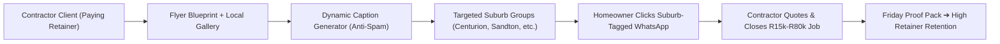

# 📢 Community Group Flyer Templates & Distribution Playbook

> **The Retainer Growth Engine:** How to execute done-for-you local marketing for paying contractor clients on the **R1,500 – R2,500/month retainer**. By posting high-converting, suburb-specific project flyers into vetted homeowner groups 3x/week, you generate steady inbound residential calls for your contractors while maintaining high monthly retention.

---

## 🎯 The Distribution System Architecture



---

## 🎨 6 High-Converting Flyer Blueprints & Copy Templates

### Blueprint 1: Emergency & Fast Response (Plumbing, Geysers, Leaks)
* **Visual Style:** Bold high-contrast banner (Navy & Safety Yellow), photo of an installed JoJo backup tank with booster pump or copper geyser installation, bold trust badges.
* **Target Audience:** Homeowners dealing with municipal water cuts or burst geysers.
* **Caption Template (Copy & Paste):**
```text
🚨 Tired of water shedding and unexpected geyser leaks in [Target Suburb]?

Get reliable backup water and precision plumbing done right the first time:
💧 JoJo Backup Water Storage Tanks + Automatic Booster Pumps
💧 Burst Geyser Replacement & Leak Detection
💧 Bathroom Renovations & High-Pressure Drain Unblocking

✅ Qualified, experienced local team
✅ Fast emergency callouts across [Target Suburb] & surrounding estates
✅ Upfront pricing — no hidden surprises

📲 Get a fast WhatsApp quote or book an assessment:
👉 https://wa.me/27[Phone]?text=Hi%20[Name],%20saw%20your%20plumbing%20post%20in%20[Target%20Suburb]
📞 Or call: [Phone]
```

---

### Blueprint 2: Luxury Home Interior (Porcelain Tiling & Kitchens)
* **Visual Style:** Sleek dark charcoal/slate aesthetic, clean daylight photo of laser-aligned polished porcelain floor tiles or a two-tone high-gloss kitchen island with quartz countertops.
* **Target Audience:** Homeowners renovating living areas, master bathrooms, or fitting custom cupboards.
* **Caption Template:**
```text
Transform your living space in [Target Suburb] with precision craftsmanship 🏡✨

Specialists in high-end residential interiors:
💎 Large-Format Porcelain & Ceramic Floor Tiling (Laser-Leveled)
💎 Full Bathroom Remodeling & Wet-Room Waterproofing
💎 Custom Fitted Designer Kitchens & Soft-Close Built-In Cupboards (BIC)
💎 Floating Acoustic TV Feature Walls with LED Accent Lighting

👨‍🔧 100% own tools & professional crew
📸 Verified photo portfolio of local estate projects
📐 Free on-site measurements & instant itemized quotes

📲 Tap to request an instant quote on WhatsApp:
👉 https://wa.me/27[Phone]?text=Hi%20[Name],%20saw%20your%20tiling/kitchen%20post%20in%20[Target%20Suburb]
🌐 View full gallery: [Live Demo URL]
```

---

### Blueprint 3: Turnkey House Builder & Structural Masonry
* **Visual Style:** Architectural badge, photo of concrete suspended rib-and-block slab or modern double-storey masonry estate home under construction.
* **Target Audience:** Landowners building in private estates or homeowners planning second-storey additions.
* **Caption Template:**
```text
Building your dream home in [Target Suburb] from the ground up 🏗️🇿🇦

From foundation trenches to roof handover, we handle your structural build with uncompromising quality:
🧱 Foundation-to-Roof Turnkey House Construction
🧱 Suspended Concrete Rib-and-Block Slabs
🧱 Boundary Perimeter Walls, Retaining Walls & Home Extensions
🧱 NHBRC-aligned engineering standards

✅ Dedicated on-site project management
✅ Clear contractual milestone payments
✅ Complete transparency on material specs

📲 Speak directly to the site builder on WhatsApp:
👉 https://wa.me/27[Phone]?text=Hi%20[Name],%20looking%20to%20build%20in%20[Target%20Suburb]
📞 Call: [Phone]
```

---

### Blueprint 4: Seasonal Roof Restoration & Waterproofing
* **Visual Style:** Dramatic 50/50 before-and-after split (dirty, weathered mossy tile roof vs. deep charcoal, freshly coated UV acrylic roof).
* **Target Audience:** Suburban homeowners protecting their property from heavy summer storms and roof leaks.
* **Caption Template:**
```text
Don't wait for the next storm to ruin your ceilings 🌧️⚡

Restore your roof to brand-new condition in [Target Suburb]:
🏠 Industrial Rotary High-Pressure Tile Washing (Moss & Lichen Removal)
🏠 UV-Reflective Acrylic Membrane Spray Coating (10+ Color Options)
🏠 Ridge Cap Re-Bedding, Pointing & Broken Tile Replacement
🏠 4mm Torch-On Bitumen Waterproofing for Balconies & Flat Roofs

🛡️ Weather-tested guarantee on all coatings
👷 Fully insured team with safety harness equipment

📲 Send your roof photos for an immediate quote:
👉 https://wa.me/27[Phone]?text=Hi%20[Name],%20need%20a%20roof%20quote%20in%20[Target%20Suburb]
```

---

### Blueprint 5: Security Gates, Aluminium Frames & Carports
* **Visual Style:** Modern powder-coated charcoal aluminium sliding folding doors or heavy-duty horizontal-slat automated sliding gate.
* **Target Audience:** Homeowners upgrading perimeter security and modernizing outdoor entertainment patios.
* **Caption Template:**
```text
Upgrade your home security & patio living in [Target Suburb] 🔒🏡

Custom fabricated steel & aluminium solutions:
🛡️ Heavy-Duty Galvanized Sliding Driveway Gates + Motor Automation
🛡️ Seamless Aluminium Window Frames & Sliding Folding Stacker Doors
🛡️ Custom Decorative Burglar Bars & Slam-Lock Trellis Security Gates
🛡️ Heavy-Duty IBR & Polycarbonate Steel Carports

⚡ Powder-coated rust-resistant finish
⚡ Factory-direct pricing with precision site fitting

📲 WhatsApp us your measurements or request a site visit:
👉 https://wa.me/27[Phone]?text=Hi%20[Name],%20saw%20your%20gates%20post%20in%20[Target%20Suburb]
```

---

### Blueprint 6: Paving, Kerbing & Driveway Resurfacing
* **Visual Style:** Wide-angle photo of a clean, laser-straight herringbone interlocking paving driveway or charcoal bevel pavers.
* **Target Audience:** Homeowners fixing cracked driveways, paving pool surrounds, or laying neat parking areas.
* **Caption Template:**
```text
Boost your property value with laser-straight driveway paving in [Target Suburb] 🚗🏡

Specialists in residential & commercial paving:
🧱 Interlocking & Bevel Driveway Paving (Heavy Traffic Rated)
🧱 Smart Paved Patio & Pool Deck Surrounds
🧱 Industrial Concrete Kerbing & Ground Compaction
🧱 Paving Repairs, Leveling & High-Pressure Deep Sealing

🚜 Complete ground preparation & rubble removal included
📐 Free square-metre measuring & quote

📲 Tap to get a quote on WhatsApp:
👉 https://wa.me/27[Phone]?text=Hi%20[Name],%20need%20a%20paving%20quote%20in%20[Target%20Suburb]
```

---

## 🛡️ Anti-Spam Posting Rules (Protecting Accounts & Maximizing Reach)

To ensure group admins welcome your posts and Meta’s spam filters never trigger:

1. **Randomized Delay Intervals:**
   * Never post to multiple groups in rapid succession. Keep an **interval of 4 to 8 minutes** between each group post.
2. **Dynamic Suburb Customization:**
   * Always edit `[Target Suburb]` to match the exact group you are posting in (e.g., inside *Centurion Classifieds*, write *Centurion / Midstream*; inside *Randburg Community*, write *Randburg / Ferndale*).
3. **Caption Rotation (3 Variations):**
   * Rotate between Blueprint variations so the exact same string of text is not posted consecutively.
4. **Direct WhatsApp Pre-Filled Link:**
   * Every post must include a pre-filled WhatsApp link naming the suburb:
     `https://wa.me/27[Phone]?text=Hi%20[Name],%20saw%20your%20post%20in%20[Suburb]`
   * This immediately tells the contractor which community group produced the lead, proving the tangible value of your monthly retainer!

---

## 📈 The Friday "Proof Pack" Retention Workflow (16:00 Every Friday)

Why do contractors stay on a R1,500/month retainer for 6–12 months? Because you show them tangible proof every Friday afternoon:

1. Open 3 of the community groups where your client's flyers ran this week.
2. Take 3 clean screenshots showing their ad, photo, and phone number live in the group.
3. Send this quick WhatsApp message to the contractor:
   ```text
   Happy Friday [Owner Name]! 🚀

   Here are your ads running live across [Group 1], [Group 2], and [Group 3] this week.

   Hope you closed some great jobs this week. Have a restful weekend, and we kick off another round of group campaigns on Monday!
   ```
4. **Outcome:** The contractor sees real marketing work happening on their behalf, feels looked after, and happily pays your monthly retainer invoice via EFT / Capitec Pay without hesitation.
