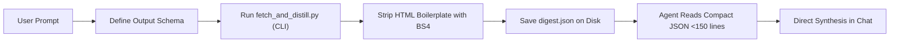

# ⚡ Global Zero-Token Research Protocol & Deep Research Runner

> [!IMPORTANT]
> **Universal Mac-Wide Enforcement:** This protocol is enforced automatically across **every workspace on your Mac** via `~/.gemini/AGENTS.md` and `~/.gemini/GEMINI.md`. It guarantees that Antigravity never burns conversation tokens by dumping bloated raw HTML or social feeds into the chat context.

---

## 🏛️ The 5 Core Principles

| # | Principle | Operational Rule |
| :-: | :--- | :--- |
| **1** | **No Raw Browser/HTML Dumping** | Never use the IDE browser or raw web-fetch tools to read bloated pages, search results, or social feeds directly into chat context unless visual UI inspection is explicitly requested by the user. |
| **2** | **Script-First Data Collection** | For any multi-page, directory, or web research task, run a local Python script silently on disk that fetches, filters, deduplicates, and parses data in milliseconds. |
| **3** | **Structured Compression on Disk** | Save raw HTML responses to `/tmp/research_raw/` and output only compact, schema-validated JSON or Markdown summaries (`digest.json` / `findings.md`, capped under 150 lines) for the agent to inspect. |
| **4** | **Progressive Skill Disclosure** | Reusable scrapers, API clients, and parsers live in global skills (`~/.gemini/config/skills/`) so scripts execute as black boxes without cluttering the agent's context window. |
| **5** | **Fresh-Context Batching** | Summarize research findings to disk at the end of each research batch so subsequent analysis, building, or writing happens with zero historical tool bloat. |

---

## 🛠️ Universal Global Skill: `deep-research-runner`

- **Skill Location:** `~/.gemini/config/skills/deep-research-runner/SKILL.md`
- **Helper Script:** `~/.gemini/config/skills/deep-research-runner/scripts/fetch_and_distill.py`
- **Discovery Symlink:** `~/.gemini/skills/deep-research-runner`

### Execution Pattern



1. **Define Output Schema First:** Agree on the required output fields (e.g. `entity`, `url`, `key_metrics`, `evidence`, `contact`) before fetching anything.
2. **Deterministic Background Fetch:** Execute `fetch_and_distill.py` with target URLs or queries silently.
3. **Local Noise Stripping:** The script automatically strips `<script>`, `<style>`, `<nav>`, `<footer>`, `<header>`, `<aside>`, and `<svg>` tags using `BeautifulSoup4`, preserving only semantic, distilled copy.
4. **Inspect Only the Digest:** Read only `./research_out/digest.json` into chat context.

---

## 📜 Distillation Engine Script Reference

The runner script is located at:
`~/.gemini/config/skills/deep-research-runner/scripts/fetch_and_distill.py`

```python
#!/usr/bin/env python3
import argparse, json, re, urllib.request
from pathlib import Path
from bs4 import BeautifulSoup

def clean_html(html: str, max_chars: int = 4000) -> str:
    soup = BeautifulSoup(html, "html.parser")
    for tag in soup(["script", "style", "nav", "footer", "header", "aside", "svg"]):
        tag.decompose()
    text = re.sub(r"\n{3,}", "\n\n", soup.get_text(separator="\n", strip=True))
    return text[:max_chars]

def fetch_url(url: str) -> dict:
    req = urllib.request.Request(url, headers={"User-Agent": "Mozilla/5.0"})
    try:
        with urllib.request.urlopen(req, timeout=15) as resp:
            html = resp.read().decode("utf-8", errors="ignore")
            return {"url": url, "status": resp.status, "excerpt": clean_html(html)}
    except Exception as e:
        return {"url": url, "status": "error", "error": str(e)}

def main():
    parser = argparse.ArgumentParser()
    parser.add_argument("--urls", nargs="+", required=True)
    parser.add_argument("--out", default="./research_out")
    args = parser.parse_args()

    out_dir = Path(args.out)
    out_dir.mkdir(parents=True, exist_ok=True)
    results = [fetch_url(u) for u in args.urls]

    digest_path = out_dir / "digest.json"
    digest_path.write_text(json.dumps(results, indent=2))
    print(f"Saved {len(results)} distilled sources to {digest_path}")

if __name__ == "__main__":
    main()
```

---

## 💬 How to Invoke Across Any Topic

Whenever you need research in any Antigravity conversation—whether auditing competitors, reviewing pricing models, checking trade directories, or researching tech stacks—use this exact prompt format:

> *"Use `/deep-research-runner` to research [Topic / URLs], save structured findings to `./research_out/digest.json`, and give me a concise synthesis without opening the IDE browser."*

### CLI Direct Execution Examples:

```bash
# Research specific URLs silently into local workspace
python3 ~/.gemini/config/skills/deep-research-runner/scripts/fetch_and_distill.py \
  --urls "https://example1.com" "https://example2.com" \
  --out ./research_out

# Inspect the structured digest
cat ./research_out/digest.json
```

---

## 🔗 Related Vault Assets
- [[Skill - Lean Agent Optimizer]] — Additional architectural patterns for token slashing.
- [[92% Cost Reduction & Lean Execution System]] — Local pipeline benchmarks and cost breakdowns.
- [[Strict Lead Qualification & Jev Scoring Protocol]] — 4-Pillar zero-false-positive vetting protocol.
