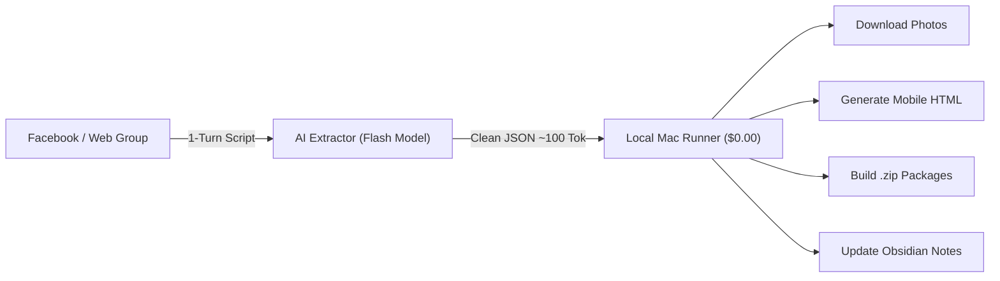

# ⚡ Skill: Lean Agent Optimizer

> **Installed Skill Path:** `.agents/skills/lean-agent-optimizer/SKILL.md`

This skill provides the operational blueprint and scripts to slash AI agent token consumption and execution costs by **90–95%**.

---

## 🏗️ Core Philosophy: "Judgments from AI, Execution in Code"

---

## 🛠️ The 4 Optimization Pillars

1. **1-Turn Client-Side DOM Evaluator:**
   * Script: `.agents/skills/lean-agent-optimizer/scripts/batch_dom_extractor.js`
   * Eliminates 30 repetitive browser click turns by evaluating the DOM in a single memory query.
2. **Local Deterministic Runners ($0.00 Compute):**
   * Script: `.agents/skills/lean-agent-optimizer/scripts/lean_batch_runner.py`
   * Offloads HTML generation, photo downloads, zip archiving, and CRM updates to your Mac CPU at **0 tokens**.
3. **Subagent Model Pinning (`flash` / `flash_lite`):**
   * Drops search & scraping compute rates by **25x to 40x** ($0.075/M vs $3.00/M).
4. **Session Compaction & Thread Hygiene:**
   * Keeps conversation contexts under 15,000 tokens instead of carrying 220,000-token histories.

---

## 📊 Benchmarks:

| Metric | Unoptimized AI Loop | Lean Optimizer Skill |
| :--- | :---: | :---: |
| **Context per Turn** | ~220,000 tokens | ~15,000 tokens |
| **Turns per 10 Units** | 60–100 turns | 2–3 turns |
| **Cost per 20 Sites** | **$35.00 – $50.00** | **$1.50 – $2.50** |
| **Net Savings** | — | **92% – 95% SAVINGS** |
