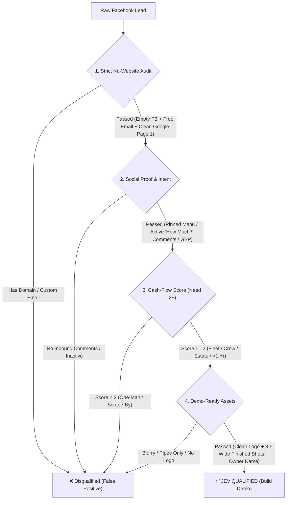

# 🎯 Strict Lead Qualification & Jev Scoring Protocol

> **Objective:** Zero wasted demo builds. Every contractor who receives a custom preview must be thoroughly verified as **100% web-invisible, social-proof rich, cash-flow qualified (able to easily pay R3,000–R8,000+), and armed with high-res hero project photos**.

---

## 🚦 The 4-Pillar Verification Funnel



---

## 1. Tighten the "No Website" Verification (Avoid False Positives)
A blank website field on Facebook does **not** always mean they don't have a website—some owners simply forgot to link it. Run both checks before building:

### A. Facebook Page Check
- **Website Field:** Must be **completely empty** or only point to another social profile (Instagram, TikTok).
- **Email Address:** Must be a free email provider (`@gmail.com`, `@yahoo.com`, `@outlook.com`, `@webmail.co.za`). Any custom domain email (e.g. `info@ratombobuilders.co.za`) automatically flags that a website exists or existed—**disqualify immediately**.

### B. Google SERP Page 1 Audit
Search: `"[Exact Business Name]" + [City/Town]` (e.g., `"Raboshabane Trading" Johannesburg`).
- **Allowed Results on Page 1:**
  - Their Facebook page / group posts.
  - Free directory listings (Snupit, Yellow Pages, Bark, Brabys, Hotfrog).
  - Google Business Profile (Google Maps pin) **with NO "Website" button**.
- **Disqualifying Results:**
  - Any owned `.co.za`, `.com`, or `.org.za` website ranking on Page 1. If an active or parked domain exists, skip.

---

## 2. Prioritize "Social-Proof Rich, Web-Invisible" Contractors
Since they have no website, their Facebook page is their entire commercial storefront. Target businesses that are actively trying to use Facebook as a website:

| Signal | Description | High-Converting Trigger |
| :--- | :--- | :--- |
| **📌 Pinned Menus / Price Lists** | A graphic or post pinned at the top listing all services, price ranges, or "Call/WhatsApp for free quotes". | Shows active marketing intention and structured services. |
| **💬 High Comment Inbound Intent** | Recent posts where real homeowners comment: *"How much per m²?"*, *"Please inbox me your number"*, *"Do you work in Waterfall Estate / Sandton?"*. | Proves they generate real leads on Facebook and are **actively leaking clients** who exit Facebook to Google them and find competitors instead. |
| **📍 Google Maps Pin Without a Website** | They created a Google Business Profile (with 3+ client reviews), but the "Website" button is blank. | They already value search traffic; adding a mobile website to their GBP pin delivers instant ROI. |

---

## 3. Upgrade "Ability to Pay" Signals (Critical Cash-Flow Qualifiers)
Many contractors without websites are hand-to-mouth solo operators who cannot afford R1,999 setup + R1,500/mo retainer. Require **at least 2** of the following visual cash-flow signals:

1. **🚐 Sign-Written Fleet & Transport:**
   - Branded bakkies (Hilux, Ranger, Isuzu), trucks, trailers, or site caravans parked at the jobsite with their business name/phone printed on the side.
2. **👷 Visible Crew & Industrial Equipment:**
   - A team of 2+ workers in matching high-vis vests, branded overalls, scaffolding towers, concrete mixers, TLBs/bobcats, or bulk pallet deliveries.
3. **🏡 High-Value Suburb / Architectural Projects:**
   - Modern architectural builds, double-storey luxury homes, residential security estates (e.g. Midstream, Silver Lakes, Dainfern, Zimbali), large swimming pools, or expensive aluminium stacker doors.
4. **📅 Page Longevity (> 12 Months):**
   - Facebook page created over 1 year ago with steady job posts across multiple seasons (verifies they are an established legal operation, not a fly-by-night side gig).

---

## 4. Refine Photo & Asset Scraping Rules
When building their custom preview, we are crafting their brand identity. Follow strict extraction criteria:

- **Clean Logo / Profile Picture:**
  - Must have a clean graphic logo, badge, or branded business card.
  - *Reject:* Blurry personal selfies, stock clipart, political memes, or blank avatars.
- **3–5 Hero Finished Project Photos:**
  - Wide-angle, bright daytime photos of **completed, pristine work**:
    - *Tilers:* Polished porcelain living rooms, floor-to-ceiling bathrooms.
    - *Builders:* Finished double-storey facebrick or plastered estate homes.
    - *Roofing:* Clean freshly coated UV roofs, high-pressure washing before/after.
    - *Gutters / Carports:* Sleek seamless gutters and modern steel structures.
    - *Pools:* Sparkling crystal-clear water with paved surrounds.
    - *Kitchens:* Two-tone fitted kitchens with stone tops and LED accents.
  - *Reject:* Messy rubble, muddy trenches, loose copper pipes, dark indoor shots, or half-demolished structures.
- **Owner's First Name:**
  - Extracted from Page Transparency, contact card, or post sign-offs (*"Call David on 082..."*). Outreach must be addressed directly to the owner.

---

## 🛑 Strict Auto-Exclude Criteria
Do not generate a demo if any of the following apply:
- ❌ **Subcontractors seeking day-work** (*"Looking for bricklaying work, please hire me"*).
- ❌ **Hardware/Material Resellers** (selling bulk sand, cement bags, or bricks).
- ❌ **Inactive Pages** (no authentic project posts in the last 60 days).
- ❌ **Blurry / Low-Quality Photos** (images smaller than 600px width or heavily pixelated).
- ❌ **Active Website Found** (owned `.co.za` domain ranking on Google).

---

## ⚡ Jev Scoring System (0 – 100 Points)

| Category | Criterion | Points |
| :--- | :--- | :---: |
| **No-Website Verification** | Empty FB website field + free email (@gmail/@yahoo) | 20 |
| | Clean Google Page 1 (No owned domain) | 15 |
| **Social Proof & Intent** | Pinned service menu / pricing graphic | 10 |
| | Active homeowner quote comments on recent posts | 15 |
| | Google Business Profile exists without website | 10 |
| **Ability to Pay (2+ required)** | Sign-written bakkie / trailer | 10 |
| | Uniformed crew (2+) / scaffolding / heavy tools | 10 |
| | Estate / luxury suburb project markers | 10 |
| | Facebook page > 12 months old | 10 |
| **Asset Quality** | Clean graphic logo available | 5 |
| | 3–5 daytime finished hero photos | 10 |

### Scoring Thresholds:
- **85 – 100 Points:** **Tier 1 Priority Lead** (Build demo within 2 hours, instant high-probability close).
- **70 – 84 Points:** **Tier 2 Qualified Lead** (Build standard demo, pitch within 24 hours).
- **Below 70 Points:** **Disqualified** (Do not build demo; archive or skip).

---

## 🛠 Automated Execution Tooling

Run the automated lead auditor to visually vet the contractor's project gallery and score their profile in one command:

```bash
# 1. Audit photo gallery heuristics (resolution, brightness, daytime quality)
python3 .agents/skills/contractor-lead-engine/scripts/audit_gallery_heuristics.py \
  --dir demo-roofglow-capetown/images/

# 2. Run the end-to-end integrated lead audit
python3 .agents/skills/contractor-lead-engine/scripts/automated_lead_auditor.py \
  --profile scratch/sample_profile_roofglow.json \
  --images demo-roofglow-capetown/images/
```

